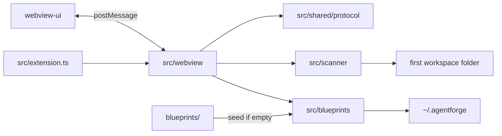

# AgentForge

Local-first VS Code and Cursor sidebar for versioned AI prompt blueprints. It reads Markdown from `~/.agentforge/blueprints`, fills variables from the open workspace, and copies the compiled prompt to the clipboard.

## Architecture

Two bundles from [esbuild.mjs](esbuild.mjs):

- `dist/extension.js` — Node CJS extension host. `vscode` stays external.
- `dist/webview.js` — browser IIFE for the sidebar, plus `dist/webview.css` from the Tailwind CLI.

```
src/extension.ts          activate, commands, workspace-folder refresh
src/webview/              sidebar provider, validation, clipboard launch
src/blueprints/           parse, compile, resolve, version, disk store
src/scanner/              stack, folder tree, rule excerpts
src/shared/protocol.ts    host/webview messages
webview-ui/               React sidebar
blueprints/               bundled seed Markdown
```

The host scans only the first workspace folder. User blueprints live in `~/.agentforge/blueprints`. History snapshots live in `~/.agentforge/history/<id>/<version>.md`. Files in `blueprints/` are copied only when the user directory has no `.md` files.



## Tech stack

- TypeScript strict (`ES2022`, `jsx: react-jsx`), React 19, Tailwind 4, gray-matter, Vitest
- VS Code engine `^1.85.0`
- Extension entry: `./dist/extension.js`. Sidebar view id: `agentforge.sidebar`

## Commands

- `npm install`
- `npm test` — Vitest, `src/**/*.test.ts` only
- `npm run compile` — extension, webview, and CSS
- `npm run watch` — same, watching. F5 **Run Extension** uses this
- `npm run package` — compile, then `vsce package --no-dependencies`, which writes `agentforge-<version>.vsix`

## Conventions

- ESM source, double quotes, strict TypeScript. Do not add `any`.
- Colocate tests as `*.test.ts` beside the module under `src/`. The webview has no test runner.
- Keep `vscode` out of `src/blueprints`, `src/scanner`, and `webview-ui`. The sidebar talks to the host only through `postMessage`.
- Do not persist user blueprints inside the repo. `blueprints/` is a seed, not the live store.
- `media/` is the activity-bar icon. `.vscode/` is the Extension Development Host launch config.

## Keeping these docs current

After a change that alters a module’s public types, the message protocol, the on-disk blueprint format, scan limits, or directory responsibilities, read the affected `AGENTS.md` files and update them in the same change. Leave them alone when behavior and contracts stay the same.

## Index

- [src/AGENTS.md](src/AGENTS.md) — extension host composition
- [src/blueprints/AGENTS.md](src/blueprints/AGENTS.md) — blueprint domain and store
- [src/scanner/AGENTS.md](src/scanner/AGENTS.md) — workspace scan
- [src/shared/AGENTS.md](src/shared/AGENTS.md) — message protocol
- [src/webview/AGENTS.md](src/webview/AGENTS.md) — sidebar host
- [webview-ui/AGENTS.md](webview-ui/AGENTS.md) — React sidebar
- [blueprints/AGENTS.md](blueprints/AGENTS.md) — bundled seeds
