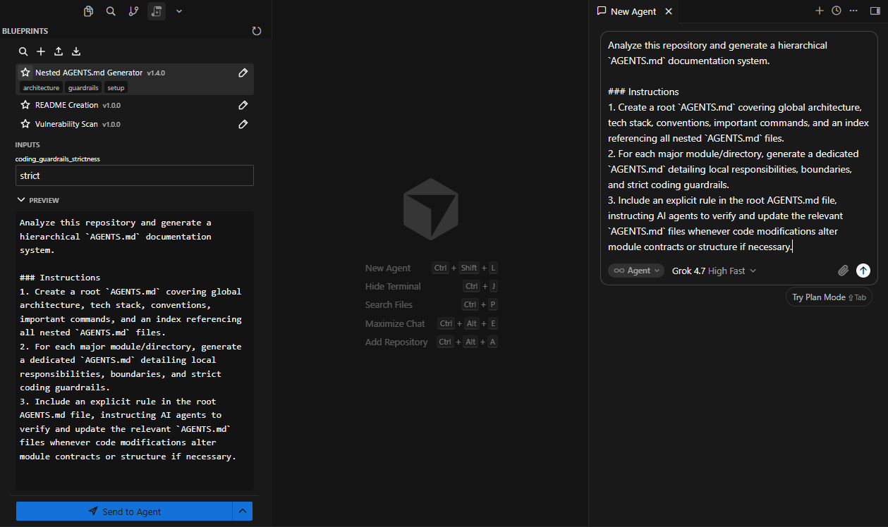

# AgentForge

Local sidebar for versioned AI prompt blueprints in Cursor and VS Code.

AgentForge reads Markdown blueprints from your user profile, fills variables from the open workspace, and either places the compiled prompt in Cursor's agent input or copies it to the clipboard.



## Features

- A sidebar library with search, tags, and favorites.
- A live preview of the compiled prompt.
- Variables you type, and variables filled from the workspace: framework, dependencies, `AGENTS.md` and `.cursor/rules` excerpts, and a folder tree.
- Create and edit blueprints in the sidebar. Each blueprint is Markdown with YAML frontmatter.
- Version history, diff, and rollback. Older copies are kept under `~/.agentforge/history`.
- Export and import of a JSON bundle (`agentforge-blueprints`) so you can share the current text of a blueprint. History snapshots and favorites stay on this machine.
- A seed blueprint, the Nested AGENTS.md Generator, copied in the first time the blueprint folder has no Markdown files.

## Install

AgentForge is installed from a VSIX you build locally. It is not published to the Visual Studio Marketplace or Open VSX.

You need Node.js, and Cursor or VS Code 1.85 or newer.

```bash
npm install
npm run package
```

`npm run package` compiles the extension and writes `agentforge-0.3.2.vsix`. The filename follows the `version` in `package.json`.

Install that file from the command palette with **Extensions: Install from VSIX...**, or from a terminal:

```bash
cursor --install-extension agentforge-0.3.2.vsix
```

```bash
code --install-extension agentforge-0.3.2.vsix
```

Open the AgentForge icon in the activity bar.

## Where files live

Blueprints are stored for your user account and shared across workspaces:

- `~/.agentforge/blueprints`
- `~/.agentforge/history/<id>/<version>.md`

On Windows those folders are under `%USERPROFILE%\.agentforge`.

## Limitations

AgentForge was exercised primarily in Cursor.

**Send to Agent** calls Cursor commands (`composer.focusComposer`, `composerMode.agent`, and `aichat.newchataction`). In VS Code the prompt is copied to the clipboard for you to paste.

The workspace scan uses the first workspace folder. Rule excerpts stop at depth 6, 50 files, and 500 characters. The folder tree skips dependency and build directories (`node_modules`, `.git`, `dist`, `out`, `build`, `coverage`, `__pycache__`, `target`, `.venv`, `venv`) and symlinks.

Compilation stays on your machine. AgentForge does not send prompts or workspace contents anywhere.

## Development

```bash
npm test
```

Press F5 and choose **Run Extension** to open an Extension Development Host with AgentForge loaded. Module boundaries are described in [AGENTS.md](AGENTS.md).

## Contact

Report bugs, or write about anything else, to [lorenzo.devia.rubio@gmail.com](mailto:lorenzo.devia.rubio@gmail.com).

## License

AgentForge's own code is [BSD Zero Clause](LICENSE), Copyright (c) 2026 Lorenzo Devia Rubio.

The scroll in the activity-bar icon is a modification of the VMware Clarity scroll icon, Copyright (c) 2018 VMware, Inc., MIT, from <https://github.com/vmware/clarity-assets>. The sparkle on that icon is original. React, gray-matter and the libraries it loads, esprima, and the Tailwind-generated stylesheet keep their own licenses. The copyright and permission notices are in [THIRD-PARTY-NOTICES.md](THIRD-PARTY-NOTICES.md).

AgentForge was written with the assistance of AI coding tools. Lorenzo Devia Rubio is the author and maintainer.
