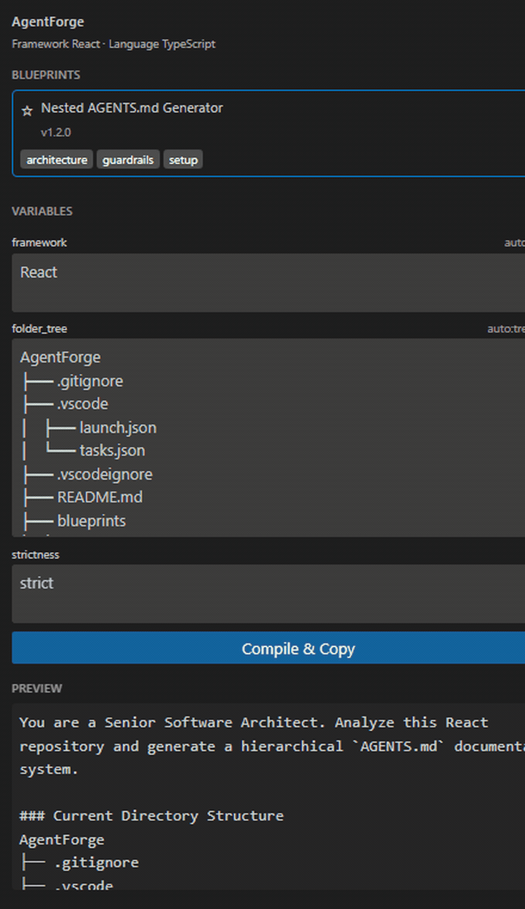

# AgentForge

Local-first command center for versioned AI prompt blueprints inside Cursor and VS Code.

AgentForge reads Markdown blueprints from `~/.agentforge/blueprints`, fills variables from the open workspace, and copies the compiled prompt so you can paste it into the agent input.



## Install

```bash
cursor --install-extension agentforge-0.1.0.vsix
```

Open the AgentForge icon in the activity bar. The first time the blueprint folder is empty, the Nested AGENTS.md Generator is copied in for you.

## Develop

```bash
npm install
npm test
```

Press F5 and choose **Run Extension**. That opens an Extension Development Host with AgentForge loaded.

`npm run package` compiles the extension and writes `agentforge-0.1.0.vsix`.
